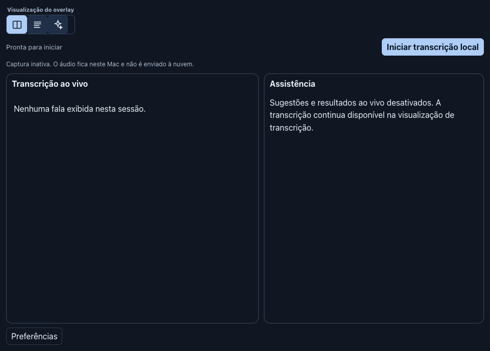
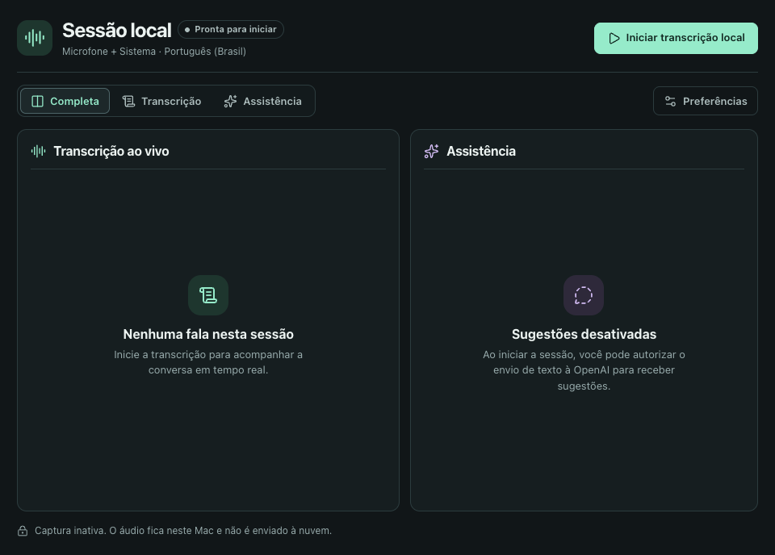
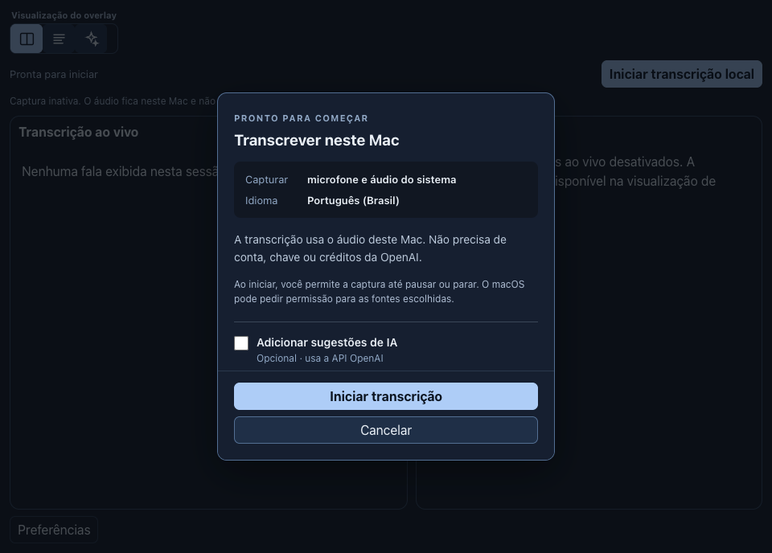
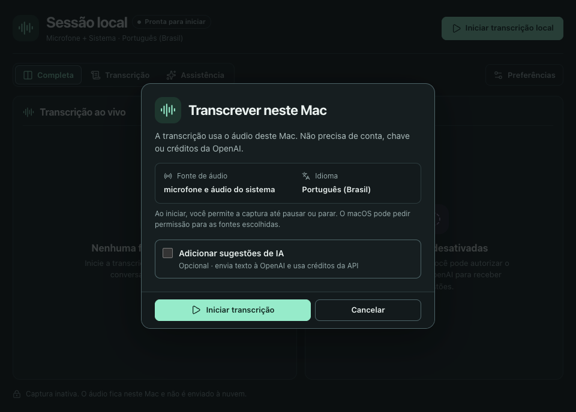
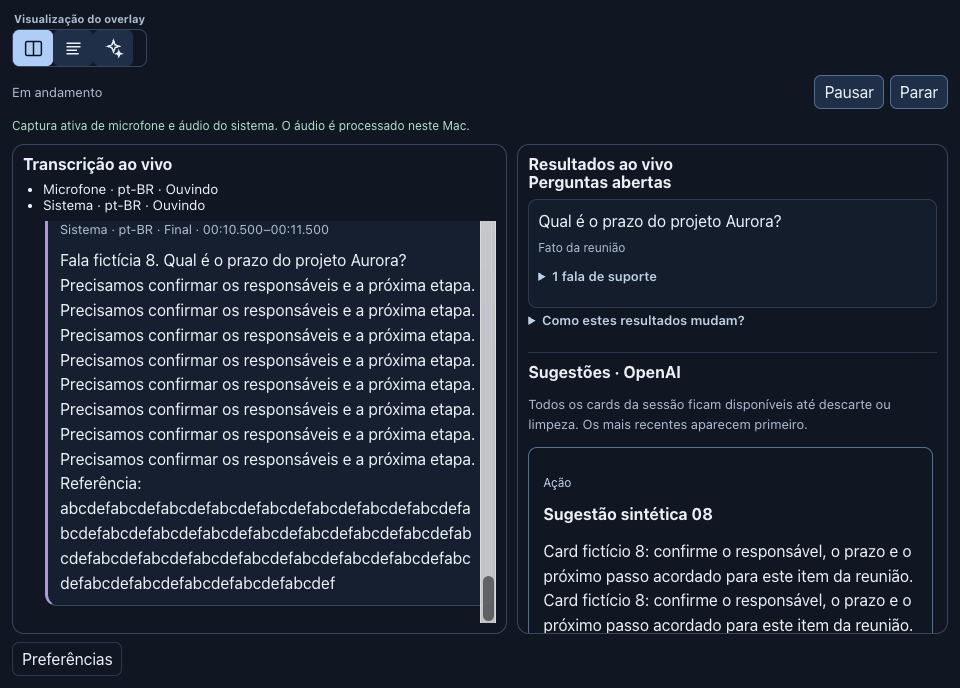
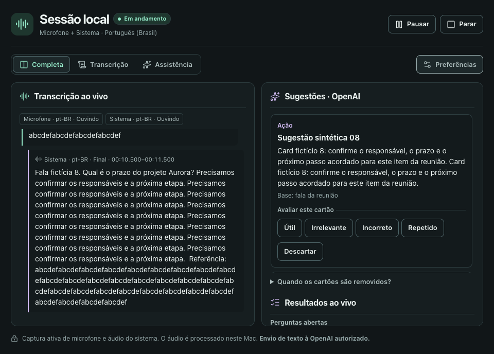
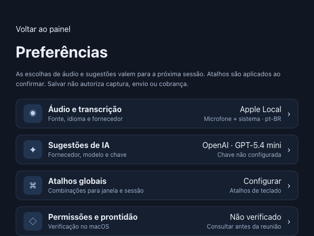
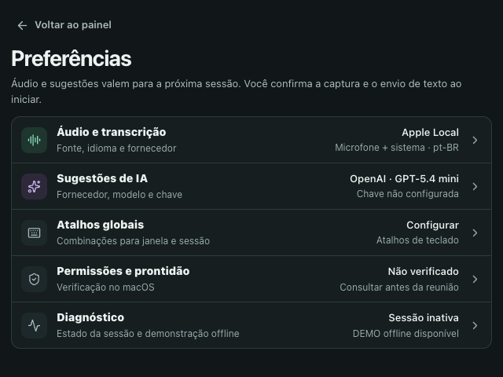

# T080 — Redesign da experiência de reunião

Em 25/11/2026, a revisão com Product Design acompanhou a jornada de iniciar uma sessão, decidir sobre o envio de texto, consultar falas e sugestões e abrir Preferências. As capturas vêm da janela do Electron com dados sintéticos. A referência inicial é o commit `8221677`.

| Etapa                                        | Antes                                                                                                             | Depois                                                                                                                     |
| -------------------------------------------- | ----------------------------------------------------------------------------------------------------------------- | -------------------------------------------------------------------------------------------------------------------------- |
| 1. Encontrar o início da sessão              |                    |                                 |
| 2. Conferir a captura e o uso opcional da IA |                      |                          |
| 3. Acompanhar uma reunião                    |              |        |
| 4. Encontrar uma área de Preferências        |  |  |

1. **Painel.** A primeira linha era dedicada a três ícones de visualização. Agora o estado da sessão, a fonte, o idioma e a ação principal aparecem juntos. As visualizações têm rótulos e compartilham a segunda linha com Preferências. As áreas vazias explicam como fazer o conteúdo aparecer.
2. **Início.** A confirmação já distinguia captura local e assistência opcional. O novo diálogo agrupa fonte e idioma e informa o envio de texto e o uso de créditos junto à própria caixa de seleção. Cancelar devolve o foco à ação de início.
3. **Reunião.** Os resultados e as instruções de retenção ocupavam a área acima do primeiro cartão. A assistência agora abre com a sugestão mais recente. Os resultados e suas falas de suporte ficam abaixo da lista rolável. O rodapé acompanha a captura e a autorização de envio de texto, inclusive na visualização só de transcrição.
4. **Preferências.** Na janela compacta, o último destino ficava abaixo da primeira tela. A lista reúne as cinco áreas e seus valores salvos. Em zoom alto, o resumo de cada área passa para baixo do nome, na ordem de leitura.

## Verificação

O plano foi capturar quatro etapas no Electron, corrigir os problemas observados no renderer e repetir os mesmos percursos e dimensões com os mesmos dados. Os cinco cenários de referência passaram antes da implementação. Na versão final, a suíte completa do Electron passou em uma única execução com **34/34** cenários. `npm run verify` aprovou lint, formatação, tipagem, build, **1.024 testes Vitest** (21 ignorados) e **19 testes do runner**.

O ensaio no Electron confere se o título do cartão mais recente está visível antes de rolar, se as cinco áreas cabem na janela nativa mínima e se a fonte e o idioma exibidos continuam os da sessão ativa após salvar novas preferências. O teste a 200% percorre falas, cartões, avaliações, evidências, consentimento e retorno ao painel. Quando a altura é reduzida pelo zoom, o diálogo inteiro usa uma só rolagem. [Reunião compacta](../T080/reuniao-compacta.png) · [Consentimento ampliado](../T080/consentimento-zoom.png).

O roteiro da DEMO expôs uma disputa de foco em Preferências. Após a abertura de uma área, um foco agendado para o quadro seguinte podia devolver o teclado ao botão Voltar. Um teste reproduziu essa perda antes da correção. O foco inicial agora é aplicado assim que a área é montada. A verificação de inicialização também incorpora os dois métodos de atalhos da T068 à lista explícita de métodos esperados.

No tema escuro, o contraste calculado pelas luminâncias das cores foi de 14,88∶1 para o texto principal sobre os painéis, 7,54∶1 para o texto secundário e 11,37∶1 no botão principal. Os ícones são recursos locais da coleção Lucide, com [atribuição e licença](../../../src/renderer/ui/Lucide-LICENSE.txt).

As sessões de teste usam um perfil temporário, fontes sintéticas e bloqueio de rede. O ensaio avalia layout, navegação e estado do renderer. Não houve teste com participantes, VoiceOver ou áudio de uma reunião real.
